# 🍌 Mercado Express — CP5 Java Advanced

Checkpoint 5 (FIAP · TDS · Prof. Dr. Marcel Stefan Wagner)

- **Parte 1:** Spring Security MVC + PostgreSQL + Deploy
- **Parte 2:** Microsserviços com RabbitMQ: integração de pagamento com o **Banco Tranquilo** e e-mail de confirmação

O Mercado Express é um hortifrúti *express* (frutas, verduras, legumes e sucos). Um único app web (`mercado-express`) atende a Parte 1 e o lado "loja" da Parte 2. Um segundo microsserviço (`banco-tranquilo-worker`) faz o papel da API do banco.

**Integrantes:** veja `integrantes.txt` · **IDE:** IntelliJ IDEA · **Deploy:** Render

---

## Sumário
1. [Arquitetura](#1-arquitetura)
2. [Tecnologias e Spring Initializr](#2-tecnologias-e-spring-initializr)
3. [Como executar localmente](#3-como-executar-localmente)
4. [Parte 1: Spring Security MVC](#4-parte-1--spring-security-mvc)
5. [Parte 2: RabbitMQ, Banco Tranquilo e e-mail](#5-parte-2--rabbitmq-banco-tranquilo-e-e-mail)
6. [Testes no Postman e no RabbitMQ](#6-testes-no-postman-e-no-rabbitmq)
7. [Dashboard da gerência](#7-dashboard-da-gerência)
8. [Deploy no Render](#8-deploy-no-render)
9. [Estrutura do projeto](#9-estrutura-do-projeto)

---

## 1. Arquitetura

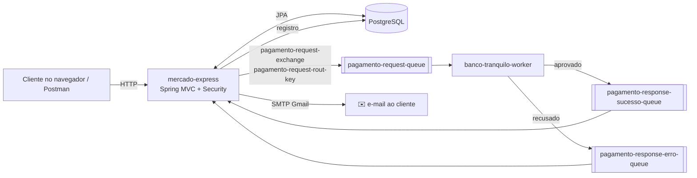

**Fluxo de uma compra:**
1. O cliente monta o carrinho e clica em **Finalizar compra** (ou faz `POST /api/compras`).
2. O `mercado-express` grava o pedido como `AGUARDANDO_PAGAMENTO`, reserva o estoque e **publica** um `PagamentoRequest` (JSON) na `pagamento-request-exchange`.
3. O `banco-tranquilo-worker` **consome** a `pagamento-request-queue`, analisa a transação e publica a resposta:
   - aprovado → `pagamento-response-sucesso-exchange`
   - recusado → `pagamento-response-erro-exchange`
4. O `mercado-express` consome a resposta:
   - **sucesso** → pedido `APROVADO` + **e-mail de confirmação** + registro na `TB_EMAIL`
   - **erro** → pedido `RECUSADO` e estoque devolvido
5. O pedido e o dashboard da gerência são atualizados.

**Regras simuladas do Banco Tranquilo** (em `banco-tranquilo-worker/.../application.yml`):

| Situação | Resultado |
|---|---|
| Valor ≤ R$ 500,00 e conta válida | ✅ Aprovado |
| Valor > R$ 500,00 | ❌ Recusado (limite) |
| Conta `00000-0` | ❌ Recusado (conta bloqueada) |

**Exchanges, queues e routing keys** (mesmos nomes da aula 17, criados automaticamente pelo `RabbitConfig`):

| Exchange (direct) | Routing key | Queue |
|---|---|---|
| `pagamento-request-exchange` | `pagamento-request-rout-key` | `pagamento-request-queue` |
| `pagamento-response-sucesso-exchange` | `pagamento-response-sucesso-rout-key` | `pagamento-response-sucesso-queue` |
| `pagamento-response-erro-exchange` | `pagamento-response-erro-rout-key` | `pagamento-response-erro-queue` |

---

## 2. Tecnologias e Spring Initializr

Java 17 · Spring Boot 3.5.6 · Maven · Spring MVC + Thymeleaf · Spring Security 6 · Spring Data JPA · PostgreSQL 16 · RabbitMQ 3 (Docker) · Spring Mail (Gmail) · Lombok · Chart.js

### `mercado-express` (https://start.spring.io)
| Campo | Valor |
|---|---|
| Project | Maven |
| Language | Java |
| Spring Boot | 3.5.x |
| Group / Artifact | `br.com.fiap` / `mercado-express` |
| Packaging / Java | Jar / 17 |
| Dependências | Spring Web, Thymeleaf, Spring Security, Spring Data JPA, PostgreSQL Driver, Validation, Spring for RabbitMQ, Java Mail Sender, Lombok, Spring Boot DevTools |

> `thymeleaf-extras-springsecurity6` foi adicionada manualmente no `pom.xml` (para usar `sec:authorize` nas telas).

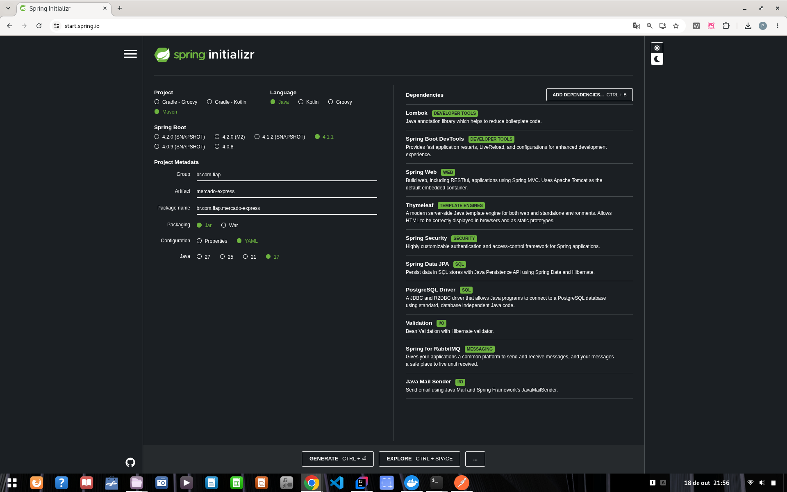

### `banco-tranquilo-worker`
| Campo | Valor |
|---|---|
| Group / Artifact | `br.com.fiap` / `banco-tranquilo-worker` |
| Dependências | Spring for RabbitMQ, Lombok, Spring Boot DevTools |

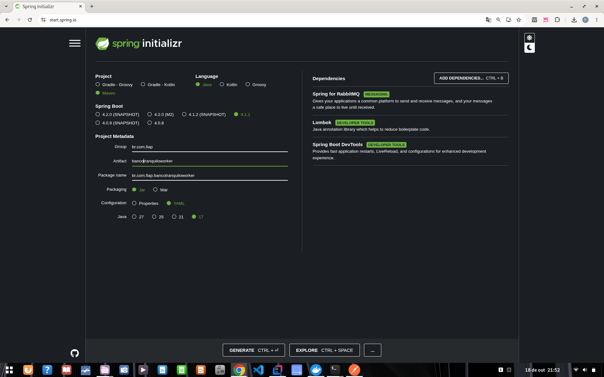

---

## 3. Como executar localmente

**Pré-requisitos:** JDK 17+, Docker Desktop, IntelliJ IDEA.

```bash
# 1) Infraestrutura: PostgreSQL + RabbitMQ
docker compose up -d
# Dashboard RabbitMQ: http://localhost:15672  (guest / guest)

# 2) Banco Tranquilo (worker)
cd banco-tranquilo-worker
mvn spring-boot:run   # ou Run em BancoTranquiloWorkerApplication no IntelliJ

# 3) Mercado Express
cd ../mercado-express
mvn spring-boot:run   # ou Run em MercadoExpressApplication
# http://localhost:8080
```

**E-mail real (opcional):** gere uma **Senha de App do Gmail** (como na aula 16) e defina, em *Run Configuration → Environment variables* do IntelliJ:

```
MAIL_USERNAME=seuemail@gmail.com;MAIL_PASSWORD=senhadeappsemespacos
```

Sem essas variáveis o sistema continua funcionando: o e-mail é gravado na `TB_EMAIL` com status `SIMULATED`.

**Variáveis de ambiente suportadas** (todas têm valor padrão para rodar localmente):

| Variável | Padrão | Uso |
|---|---|---|
| `DB_URL` | `jdbc:postgresql://localhost:5432/mercado_express` | URL JDBC do PostgreSQL |
| `DB_USERNAME` / `DB_PASSWORD` | `postgres` / `postgres` | Credenciais do BD |
| `RABBIT_HOST` / `RABBIT_PORT` | `localhost` / `5672` | Broker |
| `RABBIT_USERNAME` / `RABBIT_PASSWORD` / `RABBIT_VHOST` | `guest` / `guest` / `/` | Broker |
| `RABBIT_LISTENERS` | `true` | `false` no deploy sem RabbitMQ |
| `MAIL_USERNAME` / `MAIL_PASSWORD` | vazio | SMTP do Gmail |

**Usuários criados automaticamente:**

| Perfil | Login | Senha |
|---|---|---|
| ADMIN (gerência) | `admin@mercado.com` | `admin123` |
| CLIENTE | `cliente@mercado.com` | `cliente123` |

Também são cadastrados 10 produtos e, para os gráficos não começarem vazios, 18 vendas de demonstração (transação `DEMO-*`). Para desligar as vendas de demonstração, use `app.seed.pedidos-demo=false`.

---

## 4. Parte 1: Spring Security MVC

### Banco de dados
`application.yml` com a configuração do PostgreSQL. As tabelas são criadas pelo Hibernate (`ddl-auto: update`):

| Tabela | Conteúdo |
|---|---|
| `TDS_Sec_MVC_TB_Mercado` | Produtos: nome, categoria, descrição, preço de custo, preço de venda, estoque, unidade |
| `TDS_Users_Mercado` | Usuários: nome, e-mail (login), senha BCrypt, perfil, data de criação |

> O Spring converte os nomes para minúsculas no Postgres (`tds_sec_mvc_tb_mercado`, `tds_users_mercado`).

### Landing page: `index.html`
Rota `/` → `templates/index.html`, pública, com destaques e botões de **Entrar** e **Criar conta**.

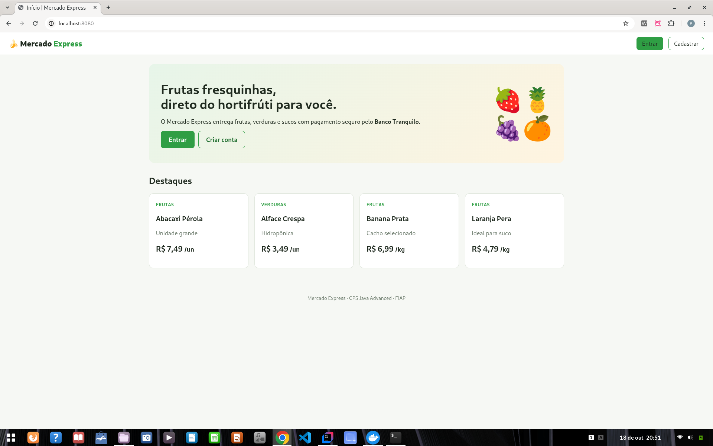

### Tela de login própria
O `SecurityConfig` troca a tela padrão do Spring por `templates/login.html` (`.loginPage("/login")`), com os campos `email` e `senha`.

- **E-mail não cadastrado:** o `AuthenticationFailureHandler` personalizado verifica na `TDS_Users_Mercado` e **redireciona para a tela de Sign Up** (`/cadastro?naoEncontrado`) com o e-mail já preenchido.
- **Senha errada:** volta ao login com a mensagem de erro.
- **Login OK:** o `AuthenticationSuccessHandler` redireciona conforme o perfil: ADMIN → `/admin/dashboard`, CLIENTE → `/produtos`.

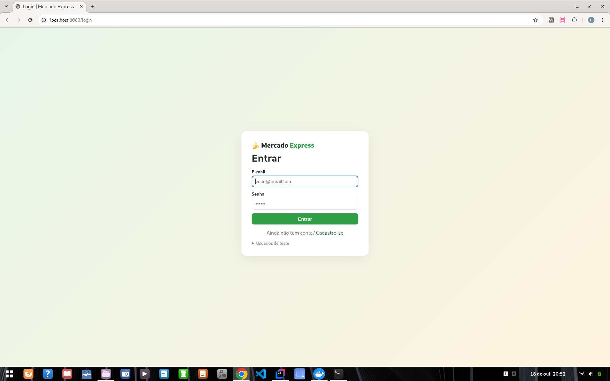

### Sign Up (cadastro)
`/cadastro` valida nome, e-mail único, senha mínima de 6 caracteres e confirmação de senha. Grava na `TDS_Users_Mercado` com senha criptografada (BCrypt) e perfil `CLIENTE`.

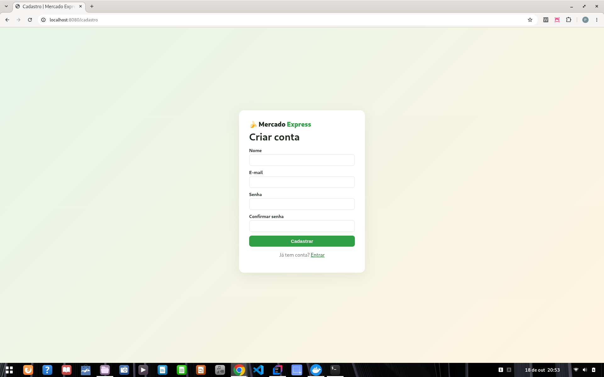

### Perfis e acessos

| Rota | Público | CLIENTE | ADMIN |
|---|:-:|:-:|:-:|
| `/`, `/login`, `/cadastro` | ✅ | ✅ | ✅ |
| `/produtos` (listar, buscar, detalhar) | | ✅ | ✅ |
| `/carrinho`, `/pedidos` | | ✅ | ✅ |
| `/produtos/novo`, `/editar`, `/excluir` | | ❌ | ✅ |
| `/admin/**` (dashboard, pedidos, e-mails) | | ❌ | ✅ |

Quem acessa sem permissão vê a página `acesso-negado`. O menu usa `sec:authorize` para mostrar só os links de cada perfil.

### CRUD de produtos (links e botões na interface)

| Operação | Botão / link | Endpoint |
|---|---|---|
| **Create** | "+ Novo produto" | `GET /produtos/novo` → `POST /produtos/salvar` |
| **Read** | lista, busca por nome, "Ver" | `GET /produtos?busca=`, `GET /produtos/{id}` |
| **Update** | "Editar" | `GET /produtos/{id}/editar` → `POST /produtos/salvar` |
| **Delete** | "Excluir" (com confirmação) | `POST /produtos/{id}/excluir` |

Exemplo de **consulta**: ao clicar em um produto, o `ProdutoController` chama o `ProdutoService`, que busca na `TDS_Sec_MVC_TB_Mercado` via `ProdutoRepository` e mostra os dados na tela de detalhe.

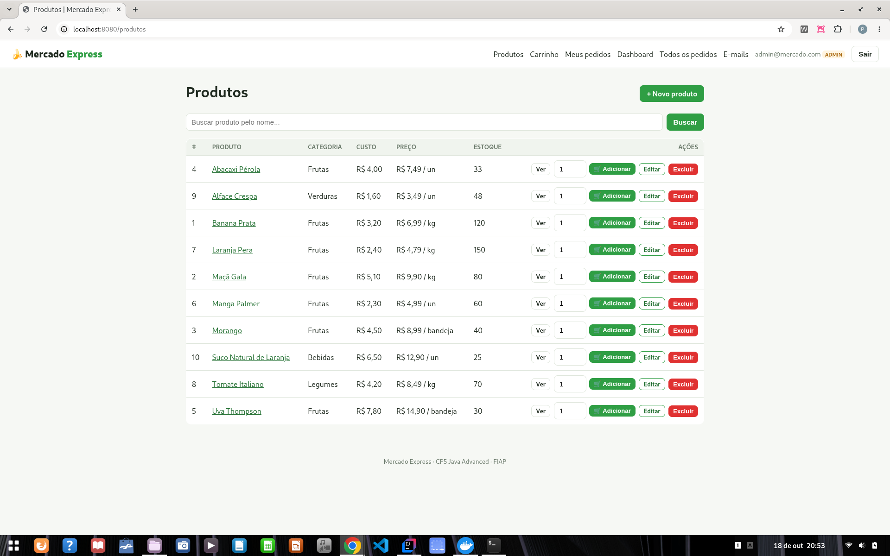
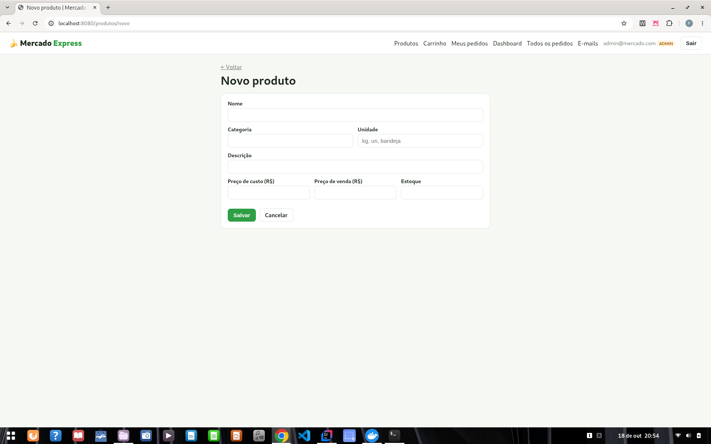
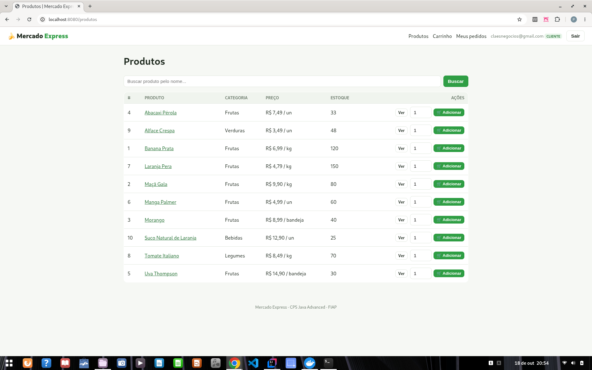

---

## 5. Parte 2: RabbitMQ, Banco Tranquilo e e-mail

### Carrinho e finalização
`/carrinho` mostra os produtos, as quantidades e o total. Ao **Finalizar compra e pagar**, o cliente informa a conta no Banco Tranquilo e o pedido é enviado ao broker. A tela do pedido recarrega sozinha até a resposta chegar.

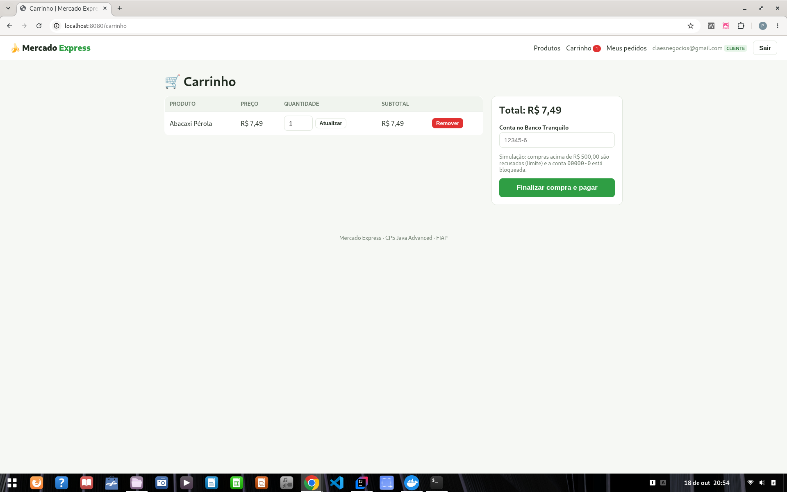
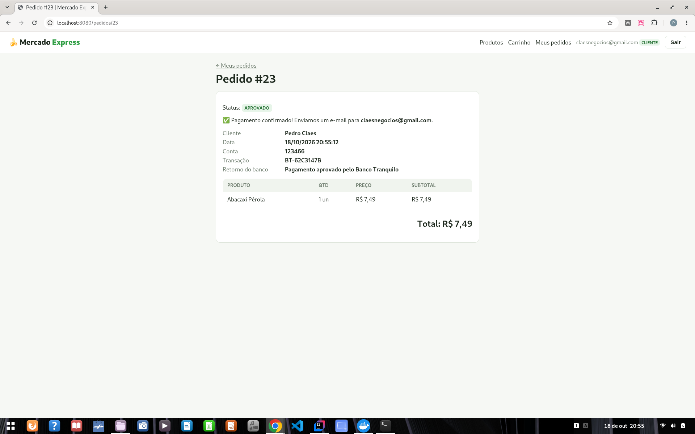

### Classes principais
| Projeto | Classe | Papel |
|---|---|---|
| mercado-express | `RabbitConfig` | Declara exchanges, queues, bindings e o conversor JSON |
| mercado-express | `CompraService` / `PagamentoProducer` | Grava o pedido e **publica** na exchange + routing key |
| mercado-express | `PagamentoResponseListener` | `@RabbitListener` das filas de sucesso e de erro |
| mercado-express | `EmailService` | Envia o e-mail (Gmail SMTP) e grava na `TB_EMAIL` |
| worker | `PagamentoRequestListener` | Consome a fila de request e publica a resposta |
| worker | `AnaliseCreditoService` | Regras de aprovação do Banco Tranquilo |

### Controle de e-mails: `TB_EMAIL`
Todo e-mail de confirmação é gravado no PostgreSQL com `pedidoId`, `emailFrom`, `emailTo`, `subject`, `text`, `sendDate` e `status` (`SENT`, `ERROR` ou `SIMULATED`). O ADMIN consulta em **/admin/emails**.

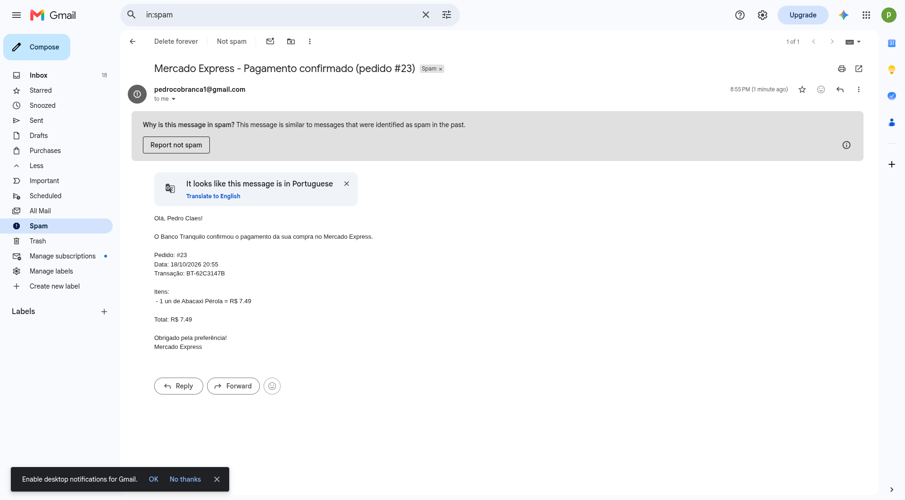
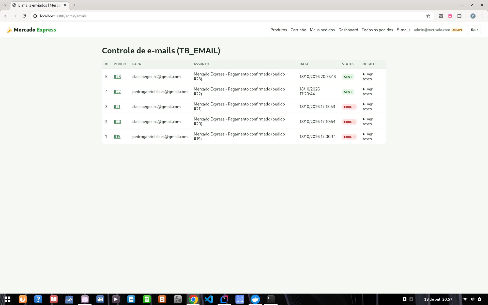

### Demais tabelas
`TB_PEDIDO` (cliente, total, custo, status, conta, código da transação, mensagem do banco) e `TB_ITEM_PEDIDO` (produto, quantidade, preço e custo no momento da compra, usados no cálculo do lucro).

---

## 6. Testes no Postman e no RabbitMQ

### Postman / Insomnia
Importe `postman/CP5-Mercado-Express.postman_collection.json`. A autenticação é **Basic Auth**, já configurada na coleção.

**Exemplo de requisição de compra**: `POST http://localhost:8080/api/compras`
```json
{
  "contaBanco": "12345-6",
  "itens": [
    { "produtoId": 1, "quantidade": 2 },
    { "produtoId": 3, "quantidade": 1 }
  ]
}
```
Resposta `202 Accepted` com o pedido `AGUARDANDO_PAGAMENTO`. Depois de ~2 s, `GET /api/compras/{id}` retorna `APROVADO` com o código da transação.

| Endpoint | Perfil | Descrição |
|---|---|---|
| `GET /api/produtos` | público | Lista produtos |
| `POST /api/compras` | logado | Cria a compra e publica no RabbitMQ |
| `GET /api/compras` / `GET /api/compras/{id}` | logado | Status dos pedidos |
| `GET /api/dashboard` | ADMIN | Indicadores em JSON |
| `GET /api/emails` | ADMIN | Registros da TB_EMAIL |

Sem Postman: `bash postman/teste-api.sh` (Git Bash).

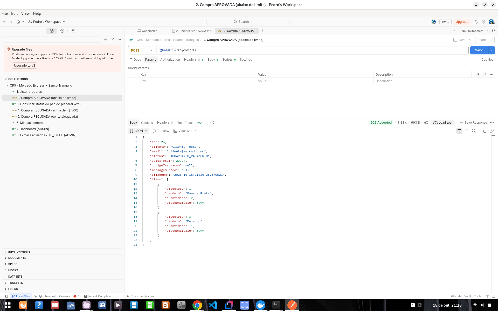

### Testes internos pelo Dashboard do RabbitMQ (http://localhost:15672)
1. **Exchanges / Queues:** as 3 exchanges e as 3 queues aparecem criadas, com os bindings em cada exchange.
2. **Publicar uma requisição manualmente:** *Exchanges → `pagamento-request-exchange` → Publish message*
   - Routing key: `pagamento-request-rout-key`
   - Properties: `content_type` = `application/json`
   - Payload (use o id de um pedido que esteja `AGUARDANDO_PAGAMENTO`, ou qualquer id para ver só o worker responder):
     ```json
     {"pedidoId": 1, "clienteNome": "Teste", "clienteEmail": "teste@email.com", "contaBanco": "12345-6", "valor": 50.00}
     ```
3. **Ver o worker parado:** pare o `banco-tranquilo-worker`, faça uma compra e veja a mensagem acumular em `pagamento-request-queue` (**Ready = 1**). Suba o worker de novo: ela é consumida e o pedido é aprovado. Isso mostra o desacoplamento entre os serviços.
4. **Get messages:** com o `mercado-express` parado, as respostas ficam nas filas de sucesso/erro e podem ser inspecionadas em *Queues → Get messages*.

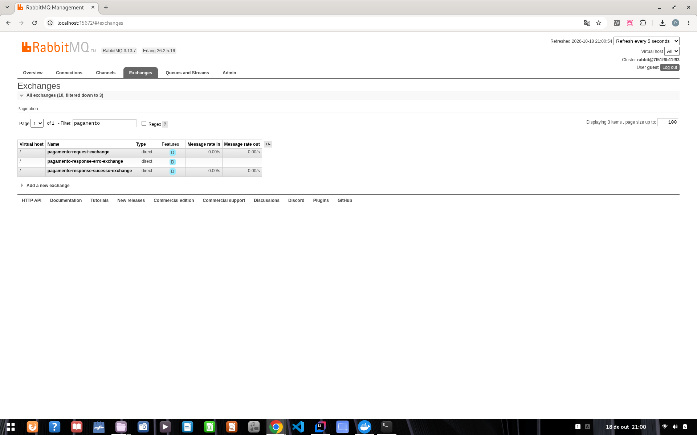
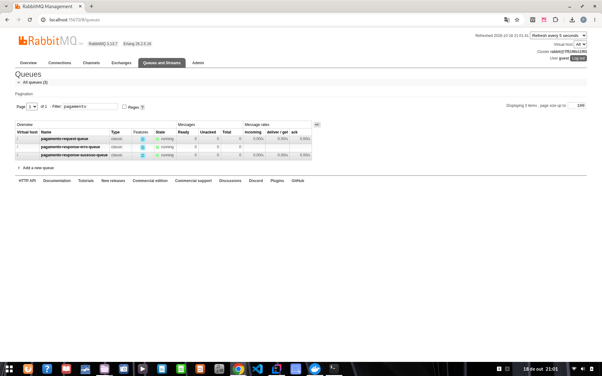

---

## 7. Dashboard da gerência
`/admin/dashboard` (ADMIN) mostra:
- **Indicadores:** faturamento, lucro bruto, pedidos aprovados, ticket médio, recusados/aguardando, itens em estoque e produtos com estoque baixo (< 20)
- **Gráficos (Chart.js):** vendas e lucro por dia (14 dias), receita e lucro por produto, estoque atual (em vermelho quando baixo) e pedidos por status
- **Últimas compras**, com link para todos os pedidos

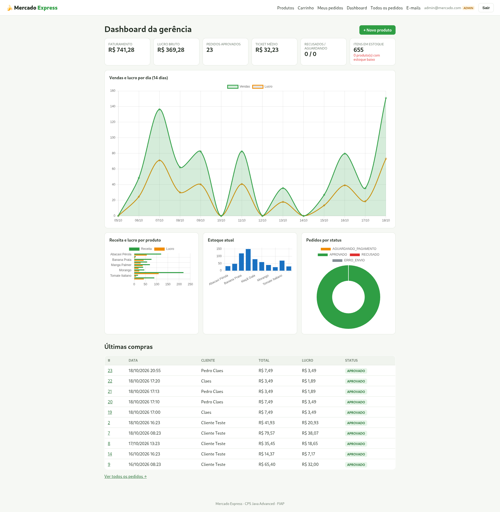

---

## 8. Deploy no Render
1. **New → PostgreSQL** (plano free). Copie *Hostname*, *Port*, *Database*, *Username* e *Password*.
2. **New → Web Service** → conecte o repositório → *Root Directory* `mercado-express` → *Runtime* **Docker**.
3. Variáveis de ambiente:
   ```
   DB_URL=jdbc:postgresql://<hostname>:5432/<database>
   DB_USERNAME=<username>
   DB_PASSWORD=<password>
   RABBIT_LISTENERS=false
   ```
   > O Render entrega a URL no formato `postgres://...`. O Spring precisa do formato `jdbc:postgresql://host:porta/banco`.
4. Deploy → `https://mercadoexpressjava.onrender.com`

No deploy da Parte 1 não há broker. Por isso os listeners ficam desligados e, se alguém finalizar uma compra, o pedido fica `ERRO_ENVIO` sem derrubar a aplicação. Para ter a integração também em produção, crie uma instância gratuita no CloudAMQP/LavinMQ, preencha `RABBIT_HOST`, `RABBIT_USERNAME`, `RABBIT_PASSWORD` e `RABBIT_VHOST`, remova `RABBIT_LISTENERS=false` e rode o worker como *Background Worker*.

🔗 **Produção:** https://mercadoexpressjava.onrender.com

---

## 9. Estrutura do projeto
```
cp5/
├── docker-compose.yml              # PostgreSQL + RabbitMQ (management)
├── integrantes.txt
├── postman/                        # coleção, JSON de exemplo e script de teste
├── mercado-express/                # Parte 1 + loja da Parte 2
│   ├── Dockerfile                  # deploy Render
│   └── src/main/
│       ├── java/br/com/fiap/mercadoexpress/
│       │   ├── config/             # SecurityConfig, RabbitConfig, DataLoader
│       │   ├── controller/         # Home, Produto, Carrinho, Pedido, Admin, Api
│       │   ├── dto/                # PagamentoRequest/Response, CompraRequest...
│       │   ├── messaging/          # PagamentoProducer, PagamentoResponseListener
│       │   ├── model/              # Produto, Usuario, Pedido, ItemPedido, Email
│       │   ├── repository/
│       │   └── service/            # Compra, Pedido, Email, Dashboard, Carrinho...
│       └── resources/
│           ├── application.yml
│           ├── static/css/style.css
│           └── templates/          # index, login, cadastro, produtos/, carrinho/, pedidos/, admin/
└── banco-tranquilo-worker/         # microsserviço do Banco Tranquilo
    └── src/main/java/br/com/fiap/bancotranquilo/
        ├── config/RabbitConfig.java
        ├── dto/
        ├── listener/PagamentoRequestListener.java
        └── service/AnaliseCreditoService.java
```

---

### Referências
- Aulas 16, 17 e 20 de Java Advanced (Prof. Marcel Wagner)
- Michelli Brito, ms-email: https://github.com/MichelliBrito/ms-email
- Documentação Spring AMQP: https://docs.spring.io/spring-amqp/reference/
